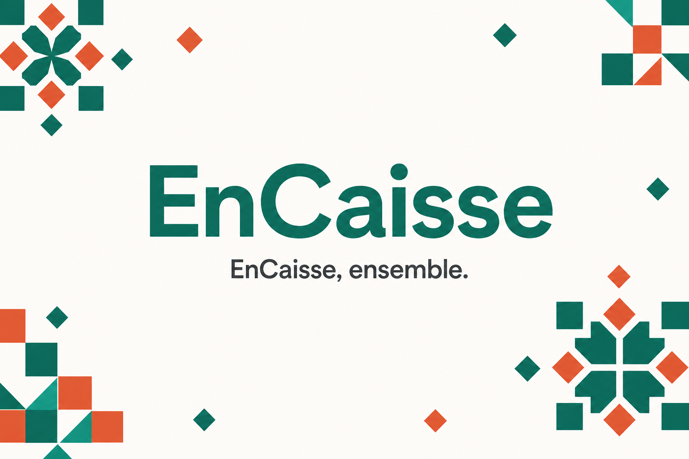
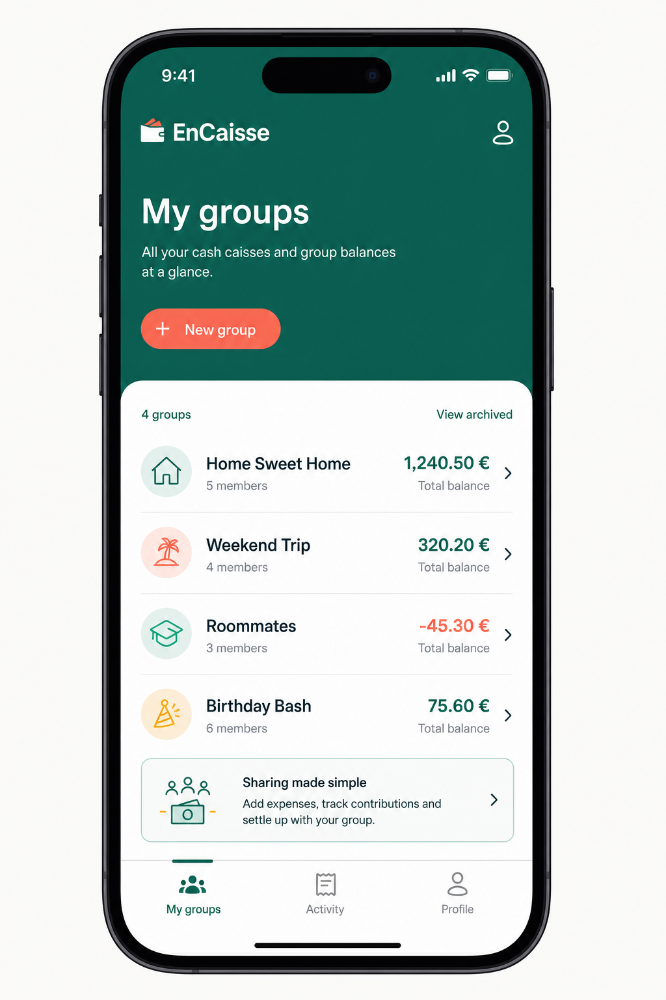
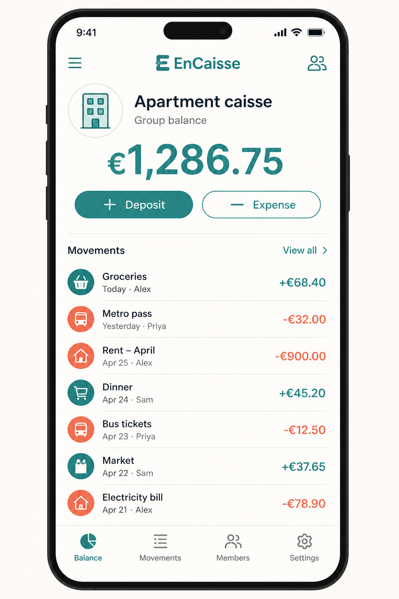
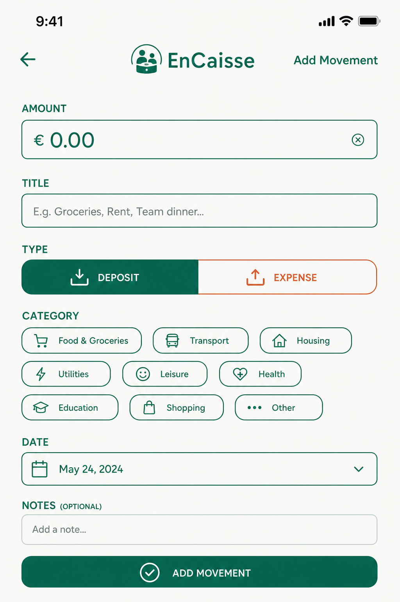

<p align="center">
  
</p>

<h1 align="center">EnCaisse</h1>

<p align="center">
  <strong>EnCaisse, ensemble.</strong><br />
  Shared group cash — track deposits, expenses, and the live balance with your circle.
</p>

<p align="center">
  
  
  
</p>

<p align="center">
  
</p>

## Preview

<p align="center">
  
  &nbsp;
  
  &nbsp;
  
</p>

## Why EnCaisse?

Roommates, family trips, and shared households need a single source of truth for money in and money out. EnCaisse keeps a **caisse** per group: everyone sees the same movements, receipts, and a balance that is always computed from history — never a stale stored total.

## Features

| | |
|---|---|
| **Auth** | Email/password and Google sign-in |
| **Groups** | Create a caisse or join with a short invite code |
| **Movements** | Deposits & expenses with categories, optional receipts, audit trail |
| **Balance** | Live total derived from movements (cannot go negative) |
| **Safety** | Soft-delete with undo window |
| **Languages** | EN · FR · AR · ES · PT · ZH · HI · RU · JA |
| **Theme** | Light, dark, or system |

## Stack

- **Flutter** + Riverpod + go_router  
- **Firebase** Auth, Cloud Firestore, Storage, Cloud Messaging  
- **AdMob** banner & interstitial  

## Getting started

### Prerequisites

- Flutter SDK (see `pubspec.yaml`)
- A Firebase project with Auth, Firestore, and Storage enabled
- Android Studio and/or Xcode

### Install

```bash
git clone https://github.com/AbdelouahedAitessaih/EnCaisse.git
cd EnCaisse
flutter pub get
```

### Configure Firebase

1. Place your config files (or regenerate them):
   - `android/app/google-services.json`
   - `ios/Runner/GoogleService-Info.plist`
2. For **Google Sign-In on Android**, add debug and release **SHA-1 / SHA-256** in Firebase → Project settings → Your Android app, then download a fresh `google-services.json`.
3. Publish rules from this repo:
   - Firestore → `firebase/firestore.rules`
   - Storage → `firebase/storage.rules`
4. Full checklist: see [`CREDENTIALS.md`](CREDENTIALS.md).

### Run

```bash
flutter run
```

### Useful commands

```bash
flutter gen-l10n
flutter analyze
flutter test
flutter build appbundle --release   # Android Play upload
```

## Android release (Google Play)

Release builds use an upload keystore referenced by `android/key.properties` (local only — never commit passwords or `.jks` files).

```bash
flutter build appbundle --release
```

Output:

`build/app/outputs/bundle/release/app-release.aab`

After Play App Signing is enabled, add the **Play App signing** SHA-1 in Firebase so Google Sign-In works for store installs.

## Project layout

```
lib/
  screens/       UI
  services/      Firebase & domain logic
  providers/     Riverpod
  models/        Data models
  l10n/          ARB + generated localizations
  widgets/       Shared UI
firebase/
  firestore.rules
  storage.rules
docs/images/     README media
```

## Brand

| Token | Value |
|-------|--------|
| Primary teal | `#0F6E56` |
| Accent coral | `#D85A30` |
| Background | `#FAFAF8` |
| Tagline | *EnCaisse, ensemble.* |

## License

Private repository — all rights reserved.
